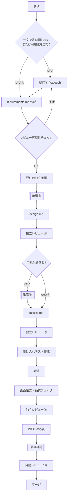

# 開発プロセス

CLAUDE.md から参照される詳細手順。作業開始時に該当セクションを読むこと。

## `.steering/` ディレクトリの命名規則

```
.steering/[YYYYMMDD]-[開発タイトル]/
```

**例:**
- `.steering/20250103-initial-implementation/`
- `.steering/20250115-add-tag-feature/`
- `.steering/20250120-fix-filter-bug/`
- `.steering/20250201-improve-performance/`

## 初回セットアップ時の手順

### 1. フォルダ作成
```bash
mkdir -p docs
mkdir -p .steering
```

### 2. 永続的ドキュメント作成（`docs/`）

アプリケーション全体の設計を定義します。
各ドキュメントを作成後、必ず確認・承認を得てから次に進みます。

1. `docs/product-requirements.md` - プロダクト要求定義書
2. `docs/functional-design.md` - 機能設計書
3. `docs/architecture.md` - 技術仕様書
4. `docs/repository-structure.md` - リポジトリ構造定義書
5. `docs/development-guidelines.md` - 開発ガイドライン
6. `docs/diagram-guidelines.md` - 図表・ダイアグラムガイドライン
7. `docs/glossary/common.md` - ユビキタス言語定義（プロジェクト横断の用語）

**重要:** 1ファイルごとに作成後、必ず確認・承認を得てから次のファイル作成を行う

### 3. 初回実装用のステアリングファイル作成

初回実装用のディレクトリを作成し、実装に必要なドキュメントを配置します。

```bash
mkdir -p .steering/[YYYYMMDD]-initial-implementation
```

作成するドキュメント:
1. `.steering/[YYYYMMDD]-initial-implementation/requirements.md` - 初回実装の要求
2. `.steering/[YYYYMMDD]-initial-implementation/design.md` - 実装設計
3. `.steering/[YYYYMMDD]-initial-implementation/tasklist.md` - 実装タスク

### 4. 環境セットアップ
内容は「環境セットアップの内容」を参照。

### 5. 実装開始

`.steering/[YYYYMMDD]-initial-implementation/tasklist.md` に基づいて実装を進めます。

### 6. 品質チェック
内容は「品質チェックの内容」を参照。

## 機能追加・修正時の手順

### 全体の流れと人間の関わり方

人間が承認・確認するのは次の箇所だけ。それ以外は、文脈を持たないサブエージェントによる
独立確認・独立レビューと、先に書いたテストで品質を担保し、自動で進める。

| 箇所 | 人間がすること |
| --- | --- |
| 承認① requirements.md | 「何を作るか」を承認する（可視化を含む場合はラフの画面イメージを添える） |
| 承認② design.md | **可視化を含む場合のみ**。確定版の画面配置と各グラフの見せ方を添えて承認する |
| 最終確認（PR） | 受け入れ条件とテストの対応表を見て、抜けがあれば追加テストを依頼する。足りていれば「Ready for review」を押す |



### 1. 影響分析

- 永続的ドキュメント（`docs/`）への影響を確認
- 変更が基本設計に影響する場合は `docs/` を更新

### 2. ステアリングディレクトリ作成

```bash
mkdir -p .steering/[YYYYMMDD]-[開発タイトル]
```

**例:**
```bash
mkdir -p .steering/20250115-add-tag-feature
```

### 3. requirements.md の作成と承認①

1. **壁打ちの要否を判定する。** 依頼が一文で言い切れないとき、または可視化
   （グラフ・レポート画面）を含むときは、壁打ちスキル `/kabeuchi`
   （`.claude/skills/kabeuchi/`）で対話し、その結果から requirements.md を作る。
   壁打ちは、痛みの具体例 → 前提 → 制約 → 代替案 → 成功基準の順に1問ずつ質問する。
   小さな修正（誤字・一行の不具合など一文で言い切れるもの）は壁打ちを省略してよい。
   **省略しても、受け入れ条件の具体例（入力と期待値の組）は必ず書く。**
2. **requirements.md を書く。** 記載内容は「作業単位ドキュメントの記載内容」を参照。
3. **レビュー可能性チェックを埋める**（requirements.md の末尾）。次の4点のどれかが
   不足なら壁打ちに戻る。人間の承認には進まない。
   - (a) 受け入れ条件が入力と期待値の組（具体例）で書けているか
   - (b) エラー時の挙動が定義されているか
   - (c) データ関数で抜けやすいケース（欠損・0や負の値・重複・カテゴリ型・
     文字列の数値・空データ）の扱いが決まっているか
   - (d) 後続のAIレビューが判断できる粒度になっているか
4. **要件の独立確認。** 会話の文脈を持たないサブエージェント（Agent ツール）に
   requirements.md **だけ**を読ませ、受け入れ条件で抜けているケースを挙げさせる
   （指示文: `.claude/skills/steering-workflow/prompts/requirements-check.md`）。
   指摘を requirements.md に反映し、反映しなかった指摘は理由を
   「独立確認／独立レビューの記録」に書く。
5. **承認①。** 独立確認の結果（指摘と対応）を添えて、人間の承認を得る。
   可視化を含む場合は、ラフの画面イメージ（モックHTML、ダミーデータのグラフ等）も添える。

### 4. design.md・tasklist.md の作成（承認①の後は自動で進む）

1. **design.md を書く。**
2. **独立レビュー①。** design.md を独立レビューにかける（後述「独立レビューの進め方」）。
3. **承認②（可視化を含む場合のみ）。** 確定版の画面配置と各グラフの見せ方を、
   目で見られる形（モックHTML等）にして添え、人間の承認を得る。
   可視化を含まない場合は承認を待たずに次へ進む。
4. **tasklist.md を書く。**
5. **独立レビュー②。** tasklist.md を独立レビューにかける。

### 5. 永続的ドキュメント更新（必要な場合のみ）

変更が基本設計に影響する場合、該当する `docs/` 内のドキュメントを更新します。

### 6. 受け入れテストの作成（実装の前・別の文脈で）

- 受け入れ条件から作るテストは、**実装の前に**、実装を行うセッションとは別の文脈
  （サブエージェント）に書かせる（指示文: `prompts/test-writer.md`）。渡すのは
  requirements.md の受け入れ条件と design.md のインターフェース部分だけ。
- 受け入れ条件1行ごとに1つ以上のテストを書き、テストの docstring に条件の番号を書く。
- 書いたテストは単独のコミットにする（`test: 受け入れテストを追加`）。

### 7. 実装

`tasklist.md` に基づいて実装を進める。

- **実装側は受け入れテストを編集しない。** テストが誤っていると考えた場合は、
  書き換えずに理由を tasklist.md に書いて報告し、テストを書いた側
  （`prompts/test-writer.md` で再起動したサブエージェントに理由と対象テストを渡す）に直させる。
- テストが通らなければ修正を繰り返す。**同じ失敗**（同じテストが同じ種類の失敗で落ちる）
  **を3回直しても通らなければ、止めて人間に報告する。** 回数は tasklist.md の
  「テスト失敗の記録」で数える。
- **可視化を含む場合**は、生成した HTML を実際に開いて操作し、画面を確認する。

### 8. 品質チェックと独立レビュー③

1. 品質チェックを実行する（「品質チェックの内容」を参照）。
2. **独立レビュー③。** 実装差分（`git diff <ベースブランチ>...HEAD`）とテスト結果を
   独立レビューにかける（指示文: `prompts/impl-review.md`）。判定に加えて、
   受け入れ条件に対する**反例となるテスト**を `tests/` 配下の `test_*_review.py` に書いて
   実行させる。受け入れテストのコミット以降にテストファイルが変更されていないことも確認させる。

### 9. 最終確認（PR）

1. PR 本文に **受け入れ条件とテストの対応表** を書く（独立レビュー③の反例テストも含める）。

   ```markdown
   ## 受け入れ条件とテストの対応
   | # | 受け入れ条件（入力 → 期待値） | テスト | 結果 |
   | --- | --- | --- | --- |
   | A-1 | ... | `tests/.../test_x.py::test_...` | ✅ |
   | R-1 | 反例：... | `tests/.../test_x_review.py::test_...` | ✅ |
   ```

   テストが書けない条件（文書の変更など）は「手動確認」とし、確認方法を書く。
2. 人間が対応表を確認する。抜けているケースがあれば追加のテストを依頼する
   （追加分も受け入れテストと同じく別の文脈で書く）。
3. 足りていれば、人間が「Ready for review」を押す。

### 独立レビューの進め方

- design.md 完成時（①）、tasklist.md 完成時（②）、実装・テスト完了時（③）の3箇所で行う。
- 作業セッションから **サブエージェント（Agent ツール）** として起動し、そのステージの
  成果物だけを渡す。前のセッションの会話履歴や経緯の要約は渡さない。

  | レビュー | 指示文（`.claude/skills/steering-workflow/prompts/`） | 渡すもの |
  | --- | --- | --- |
  | ① | `design-review.md` | design.md（判断の基準として requirements.md） |
  | ② | `tasklist-review.md` | tasklist.md（基準として design.md・requirements.md） |
  | ③ | `impl-review.md` | 実装差分とテスト結果（基準として requirements.md の受け入れ条件） |

- レビュー役は当面 Claude（作業セッションと同一モデル）に固定する。
- 指摘があれば作業セッションが修正し、再レビューを経て次のステージに進む。
  **修正と再レビューの往復は3回まで。** それでも指摘が残れば止めて人間に報告する。
- 回、指摘、対応は、対象ファイル（③は tasklist.md）の「独立確認／独立レビューの記録」に残す
  （セッションをまたいでも数えられるよう、回数はファイルで数える）。


## 作業単位ドキュメントの記載内容

3ファイルとも、末尾に **「独立確認／独立レビューの記録」** 欄を設け、
回・指摘・対応（直した／直さない理由）を残す。

### requirements.md
- 変更・追加する機能の説明
- ユーザーストーリー
- 受け入れ条件 — **入力と期待値の組（具体例）で書く**。表形式を推奨。
  正常系に加えて、境界・異常系（エラー時の挙動）を含める
- 制約事項
- **画面イメージ（ラフ）** — 可視化を含む場合のみ。「どんな画面が欲しいか」を
  絵で共有する段階。どのグラフを何枚、どんな順で置きたいか、どこを操作すると
  何が起きるか。この時点では手描き相当のラフでよく、細部は `design.md` で詰める
- **レビュー可能性チェック**（末尾。必須）

  ```markdown
  ## レビュー可能性チェック
  | 観点 | 結果 | 補足 |
  | --- | --- | --- |
  | (a) 受け入れ条件が入力と期待値の組（具体例）で書けている | ○/× | |
  | (b) エラー時の挙動が定義されている | ○/× | |
  | (c) データ関数の抜けやすいケース（欠損・0や負の値・重複・カテゴリ型・文字列の数値・空データ）の扱いが決まっている | ○/×/対象外 | |
  | (d) 後続のAIレビューが判断できる粒度になっている | ○/× | |
  ```

### design.md
- 実装アプローチ
- 変更するコンポーネント
- データ構造の変更
- 影響範囲の分析
- **画面配置（確定版）** — 可視化を含む場合のみ。グラフの並び順・段組み、
  スクロールしたときに何がどこに来るか。`requirements.md` のラフを、技術的な
  制約（データ量・描画性能・HTMLサイズ等）を踏まえて確定させたもの
- **各グラフの見せ方** — 同上。グラフ種類、縦横軸に何を取るか、色分けの意味、
  初期表示の範囲、凡例・ホバーで何を出すか。**「全期間・全件を初期表示すると
  読めるか」は必ず検討する**（時間刻みの系列や多カテゴリの棒グラフは、
  全部出すと密集して読めなくなりやすい）

### tasklist.md
- 具体的な実装タスク
- タスクの進捗状況
- 完了条件
- **テスト失敗の記録** — 同じ失敗を何回直したか（3回で停止）

## 環境セットアップの内容

```bash
uv sync                 # 依存をインストール
uv add <パッケージ名>    # 依存を追加（開発専用は uv add --dev）
```

- 実行は `uv run python scripts/<プロジェクト名>/<ツール名>.py`。
- Pythonバージョンは `.python-version` に準拠する。

## 品質チェックの内容

```bash
uv run ruff check .
uv run ruff format .
uv run mypy .
uv run pytest
```

- `pytest` はユニットテストに加え、必要に応じて結合テストも実行する。
  対象がファイルI/OやDuckDB/Parquetを介する処理であれば、`tests/` 配下に
  結合的な検証も書く。
- 最後に、実装内容が `requirements.md` の受け入れ条件を満たしているか見直す
  （独立レビュー③で、反例テストを含めて確認する）。
